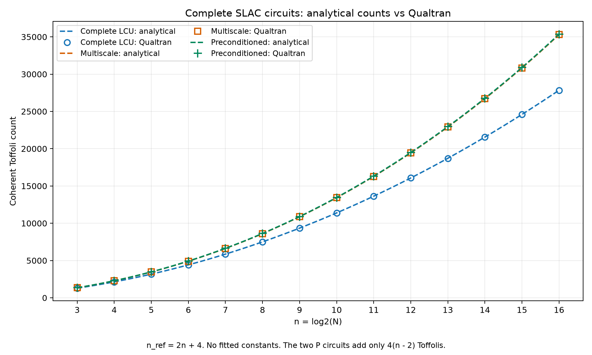

# SLAC Block Encoding in Qualtran

Explicit quantum circuits for a signed inverse-square SLAC operator, recursive
Shannon wavelet transforms, and two-sided wavelet preconditioning. The notebook
compares structural Toffoli formulas with Qualtran circuit call graphs and checks
the encoded action against classically computable reference actions.



## Run

The implementation has been exercised with Python 3.12 and Qualtran 0.7.0. The
direct dependency versions in `pyproject.toml` match the development environment.
The full transitive environment is not locked.

From this repository's directory:

```bash
python3.12 -m venv .venv
source .venv/bin/activate
python -m pip install -r requirements.txt
python -m jupyter lab slac_qualtran.ipynb
```

On Windows, activate with `.venv\Scripts\activate` instead. Run the notebook from
top to bottom. It imports the local `slac_qualtran` package and writes generated
tables and figures to the relative `results/` directory. It contains no package
installation cells or machine-specific paths.

```bash
python -m pytest -q
python -m slac_qualtran --output results
```

The command-line entry point produces the three-circuit comparison and supporting
validation, conditioning, precision, and rotation tables. No notebook execution
is required to import or use the circuit classes.

## Files

| File | Purpose | Required to run? |
| --- | --- | --- |
| `slac_qualtran.ipynb` | Compact research walkthrough with saved results | For the notebook walkthrough |
| `slac_qualtran/circuits.py` | PREP, clean inequality test, SIGN/COPY/SELECT, QSWT, and preconditioner circuits | Yes |
| `slac_qualtran/resources.py` | Gate accounting, analytical counts, component table, and rotation audit | Yes |
| `slac_qualtran/analysis.py` | Classical action checks, conditioning, and comparison plots | Yes |
| `slac_qualtran/__init__.py`, `__main__.py` | Package exports and command-line entry point | Yes |
| `pyproject.toml`, `requirements.txt` | Package and dependency installation | Yes |
| `tests/` | Focused circuit and resource regression checks | For verification |
| `figures/`, `docs/` | Preview figures and derivation note | No |
| `.gitignore`, `README.md` | Repository housekeeping and documentation | Recommended |

The original exploratory notebook, standalone scripts from that notebook, local
Python environment, and paper source are not needed in this repository.

## Operator Convention

For `N = 2**n`, the unnormalized target is

$$
\widetilde\Delta = -\frac{\pi^2}{3}I
+ \sum_{j=1}^{N/2-1}\frac{2(-1)^{1+j}}{j^2}(S^j+S^{-j}).
$$

The midpoint coefficient at `j = N/2` is **zero**. Every other coefficient is
retained, and the diagonal appears once. This is a finite circulant constructed
from truncated infinite-lattice coefficients; it differs from the exact periodic
spectral Laplacian.

The reference register uses exact integer acceptance counts, so the circuit
encodes a finite-precision approximation to these inverse-square coefficients.
Its normalization is

$$\alpha_n=\frac{\pi^2}{3}+8(1-2^{-(n-1)}).$$

The multiscale target is `W A W.conj().T / alpha_n`; two independent signal
ancillas produce `P W A W.conj().T P / alpha_n`. The constant Fourier mode is
excluded from the conditioning diagnostics, but its projection is not an
additional circuit counted here. The truncated operator need not have an exact
zero eigenvalue on that mode.

## Resource Formulas

Both `And` and `And`-adjoint count as one coherent Toffoli, including compute and
uncompute. For `n >= 3` and `n_ref = 2*n + 4`:

$$T_{\mathrm{LCU}}=100n^2+142n-32,$$
$$T_{\mathrm{MS}}=(4n^3+327n^2+371n-126)/3,$$
$$T_{\mathrm{PMS}}=(4n^3+327n^2+383n-150)/3.$$

These expressions describe the selected executable schoolbook arithmetic and
shared-control decomposition. They are not claims of globally minimal counts.
Cliffords, explicit T gates, and unsynthesized rotations are accounted for
separately. Qualtran's `PhaseGradientUnitary` supplies phase gates here; no
prepared phase-gradient state or kickback-addition circuit is used.

The resource estimates exclude rotation synthesis, physical error correction,
nullspace projection circuits, and QLSA repetitions. The acceptance and SELECT
checks exercise actual reversible classical actions; the combined block checks
use the preparation probabilities and known matrix actions rather than
contracting the complete quantum circuit.

See [the control-sharing and Toffoli derivation](docs/control_optimization_and_toffoli_derivation.pdf)
for the component derivation and worked example.

## Reuse

A reuse license has not been selected. Public availability alone does not grant
a general license to redistribute or modify this code. Choose the intended
license before a public release. The repository does not include the paper source.
